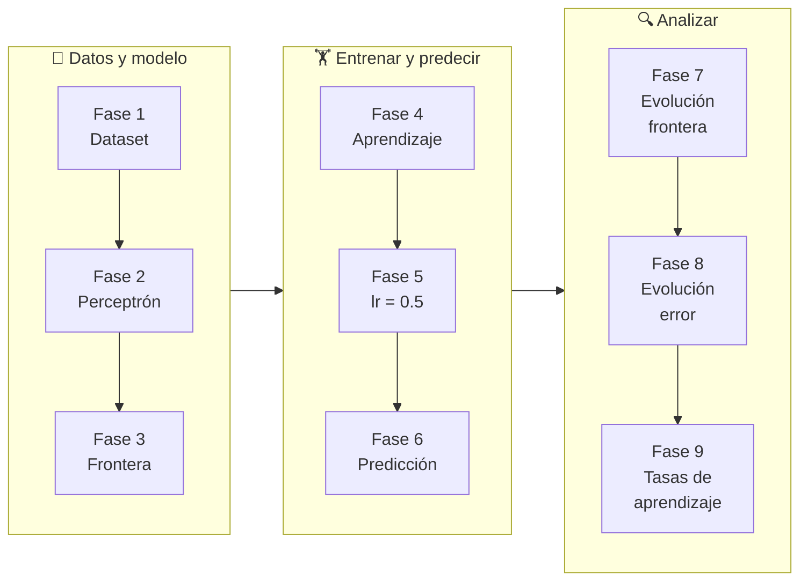

<div align="center">

# 🐍 Práctica N.º 3 · El Perceptrón

### Clasificación binaria con una unidad de decisión lineal, programada desde cero

[](https://colab.research.google.com/github/xErnyx/Practica_3_El_Perceptron/blob/main/Practica_3_El_Perceptron.ipynb)


**9 fases · 21 preguntas guía resueltas · sin librerías de machine learning**

</div>

---

## 👤 Datos académicos

| | |
|---|---|
| 🎓 **Estudiante** | Juan D. Figueroa |
| 🏫 **Universidad** | Universidad Salesiana del Ecuador · Sede Sur |
| 📚 **Carrera** | Ciencias de la Computación |
| 🤖 **Asignatura** | Inteligencia Artificial · 6.º nivel |
| 👨‍🏫 **Docente** | Ing. Rodrigo Tufiño |
| 📅 **Fecha** | 16 Noviembre de 2026 |

---

## 📖 ¿De qué trata este proyecto?

El perceptrón no es una red neuronal: es la **unidad de decisión lineal** con la que empiezan todas. Esta práctica lo programa **a mano**: calcula una suma ponderada de las entradas, la pasa por un escalón y aprende corrigiendo sus pesos cada vez que se equivoca. El dataset son 23 puntos del plano con dos clases (−1 y +1) y el objetivo es encontrar la recta que las separe. Cada fase combina:

- 📐 **Teoría:** fundamento de cada paso del modelo.
- ✏️ **Práctica:** código comentado con salidas y gráficas visibles, sin librerías de machine learning.
- 💬 **Análisis:** respuesta argumentada a cada pregunta guía, con los resultados reales de la ejecución.
- ✅ **Cierre:** introducción, objetivos, resultados, conclusiones, recomendaciones y referencias.

> [!TIP]
> Haz clic en el botón **Open in Colab** de arriba para ejecutar el notebook en tu navegador. No necesitas instalar nada.

---

## 🗺️ Ruta de aprendizaje



---

## 🧩 Contenido por fases

### 🧬 Fases 1 a 3 · Dataset, modelo y frontera

| Fase | Qué se resolvió | Concepto clave |
|:---:|---|---|
| 1 | **23 instancias**, 2 variables de entrada, 2 clases (**14** de la clase −1 y **9** de la clase +1), contadas solo con ciclos y listas | Instancia, feature, label |
| 2 | Funciones `initialize_weights()`, `activation(z)` y `perceptron_compute(x, w)` | Suma ponderada, escalón bipolar, bias |
| 3 | `perceptron_plot()` con el caso especial `w₂ = 0` (recta vertical, sin dividir entre cero) | Frontera `w₀ + w₁x₁ + w₂x₂ = 0` |

Con pesos aleatorios, la frontera inicial clasificó mal **9 de 23** puntos: se genera sin mirar los datos, así que acertar sería casualidad.

### 🏋️ Fases 4 a 6 · Entrenamiento y predicción

| Fase | Qué se resolvió | Resultado |
|:---:|---|---|
| 4 | `perceptron_learning()` con registro de error (`E_values`) y de pesos por época (`W_values`, guardando **copias**) | Regla `wᵢ ← wᵢ + η(y − ŷ)xᵢ` |
| 5 | Entrenamiento con `lr = 0.5` y `max_epochs = 1000` | **134 épocas**, **413 actualizaciones**, error final **0** |
| 6 | Clasificación de 3 instancias nuevas y dataset extendido | Ver tabla de abajo |

**Pesos del entrenamiento con `lr = 0.5`:** de `[-0.4419, 0.3662, 0.1011]` a `[-71.4419, 2.3662, 9.1011]`.

| Instancia | Salida predicha | z |
|:---:|:---:|:---:|
| `[5, 5]` | −1 | −14.11 |
| `[10, 6]` | +1 | 6.83 |
| `[6, 10]` | +1 | 33.77 |

### 🔍 Fases 7 a 9 · Evolución y comparación

| Fase | Qué se resolvió | Resultado |
|:---:|---|---|
| 7 | Seis estados del entrenamiento (inicial, 20 %, 40 %, 60 %, 80 %, final) | Errores por estado: 14, 14, 14, 14, 11, 0; pendiente de −3.62 a −0.26 |
| 8 | `plot_error()` y análisis de convergencia | El error **subió 55 veces** y llegó a 0 solo en la época 134 |
| 9 | Comparación de `lr = 0.3`, `0.5` y `0.8` con los mismos pesos iniciales, más un experimento con 30 semillas | Ninguna tasa ganó de forma sistemática |

<div align="center">

**Evolución de la frontera con `lr = 0.5`**

</div>

**Evolución del error por tasa de aprendizaje:**

| lr | Épocas | Actualizaciones | Error final | Pesos finales |
|:---:|:---:|:---:|:---:|---|
| 0.3 | 94 | 300 | 0.0 | `[-31.642, 0.966, 4.301]` |
| 0.5 | 134 | 413 | 0.0 | `[-71.442, 2.366, 9.101]` |
| 0.8 | 54 | 158 | 0.0 | `[-51.642, 1.966, 6.501]` |

---

## 💡 Conceptos clave que se aprendieron

<details>
<summary><b>🧠 ¿Cómo aprende el perceptrón?</b> (clic para expandir)</summary>

<br>

El modelo calcula `z = w₀ + w₁x₁ + w₂x₂` y predice `ŷ = 1` si `z ≥ 0` y `ŷ = -1` si `z < 0`. La frontera de decisión es la recta `z = 0`. Solo aprende cuando se equivoca, y como `y − ŷ` vale 0 o ±2, cada corrección mueve los pesos en `±2η(1, x₁, x₂)`.

```python
if y_hat != yi:                         # solo se actualiza cuando hay error
    w[0] += lr * (yi - y_hat)           # bias
    w[1] += lr * (yi - y_hat) * xi[0]   # peso de x1
    w[2] += lr * (yi - y_hat) * xi[1]   # peso de x2
```

Los tres pesos cumplen funciones distintas: `w₁` y `w₂` fijan la **inclinación** de la recta y `w₀` (el bias) su **posición**. En este dataset el bias fue el que más cambió, de −0.44 a −71.44.

</details>

<details>
<summary><b>📉 ¿Por qué el error no baja de forma continua?</b> (clic para expandir)</summary>

<br>

El perceptrón corrige **un error individual a la vez** y no minimiza una pérdida global. Arreglar un punto puede desacomodar otros, así que el error sube y baja. Con `lr = 0.5` subió en 55 de las 133 transiciones entre épocas, tuvo su máximo (0.304) en la época 55 y se repitió igual en 20 épocas. Las últimas épocas fueron 0.174, 0.043 y 0.

</details>

<details>
<summary><b>📏 Error 0 no significa modelo perfecto</b> (clic para expandir)</summary>

<br>

El error 0 solo se mide sobre los 23 puntos de entrenamiento. La recta encontrada es la **primera que separa** las clases, no la más holgada: el punto más cercano a la frontera final, `[6, 6]` de la clase −1, queda a solo **0.281** unidades. Por eso hicieron falta cientos de actualizaciones para un dataset tan pequeño y por eso no se puede asegurar un buen desempeño con datos nuevos.

</details>

<details>
<summary><b>⚖️ ¿Cuál es la mejor tasa de aprendizaje?</b> (clic para expandir)</summary>

<br>

Con los mismos pesos iniciales, `lr = 0.8` fue la más rápida (54 épocas). Pero repetir el experimento con **30 semillas distintas** mostró que ninguna tasa gana de forma sistemática:

| lr | Media de épocas | Mediana | Mín | Máx | Veces más rápida (de 30) |
|:---:|:---:|:---:|:---:|:---:|:---:|
| 0.3 | 144.6 | 130 | 42 | 351 | 8 |
| 0.5 | 129.2 | 119 | 42 | 355 | 11 |
| 0.8 | 136.7 | 115 | 29 | 372 | 11 |

Los pesos iniciales influyen tanto como la tasa de aprendizaje, por eso para comparar tasas hay que partir siempre de los **mismos pesos**. Los pesos finales son distintos, pero definen rectas parecidas (pendientes −0.225, −0.260 y −0.302) que clasifican igual el entrenamiento.

</details>

<details>
<summary><b>📋 Guardar copias de los pesos</b> (clic para expandir)</summary>

<br>

`w` se modifica en el sitio en cada actualización. Si en `W_values` se guarda la referencia, todas las posiciones apuntan al mismo array y las seis gráficas mostrarían la frontera final. Hay que guardar `w.copy()`: es la misma lógica de **vista vs. copia** de NumPy vista en el taller.

```python
W_values.append(w.copy())   # copia de los valores, no la referencia
```

</details>

<details>
<summary><b>🛑 ¿Por qué un máximo de épocas?</b> (clic para expandir)</summary>

<br>

El criterio "una época sin errores" solo se cumple si existe una recta que separe las clases. Con datos no separables el error nunca llegaría a 0 y el entrenamiento no terminaría, así que `max_epochs` garantiza que el algoritmo siempre se detenga.

</details>

---

## 🚀 Cómo ejecutarlo

**Opción 1 · En Google Colab (recomendada)**
1. Haz clic en el botón **Open in Colab** al inicio de este README.
2. Ejecuta todo con **Entorno de ejecución → Ejecutar todas**.

**Opción 2 · En local**

```bash
git clone https://github.com/xErnyx/Practica_3_El_Perceptron.git
cd Practica_3_El_Perceptron
pip install numpy matplotlib pandas jupyter
jupyter notebook Practica_3_El_Perceptron.ipynb
```

---

## 📂 Estructura del repositorio

```text
📦 Practica_3_El_Perceptron
 ┣ 📓 Practica_3_El_Perceptron.ipynb       ← notebook con fases y respuestas
 ┣ 📄 README.md                            ← descripción del proyecto
 ┗ 📄 LICENSE                              ← licencia MIT
```

---

## 🛠️ Tecnologías

| Herramienta | Uso |
|---|---|
| **Python 3** | Lenguaje de programación |
| **NumPy** | Arrays, pesos y operaciones del perceptrón |
| **Matplotlib** | Gráficas de la frontera de decisión y del error |
| **pandas** | Tablas de resultados |
| **Google Colab** | Entorno de ejecución en la nube |

---

## 📚 Referencias

- Harris, C. R., Millman, K. J., van der Walt, S. J., Gommers, R., Virtanen, P., Cournapeau, D., ... Oliphant, T. E. (2020). Array programming with NumPy. <i>Nature, 585</i>(7825), 357–362. https://doi.org/10.1038/s41586-020-2649-2

- Hunter, J. D. (2007). Matplotlib: A 2D graphics environment. <i>Computing in Science &amp; Engineering, 9</i>(3), 90–95. https://doi.org/10.1109/MCSE.2007.55

- Tufiño, R. (2026). <i>Guía de práctica de laboratorio N.° 03: El perceptrón</i> [Material de clase, Inteligencia Artificial]. Universidad Salesiana del Ecuador - Sede sur.

---

<div align="center">

Hecho con 💙 por **Juan D. Figueroa** · [@xErnyx](https://github.com/xErnyx)

⭐ Si te sirvió este repositorio, ¡déjale una estrella! ⭐

</div>
